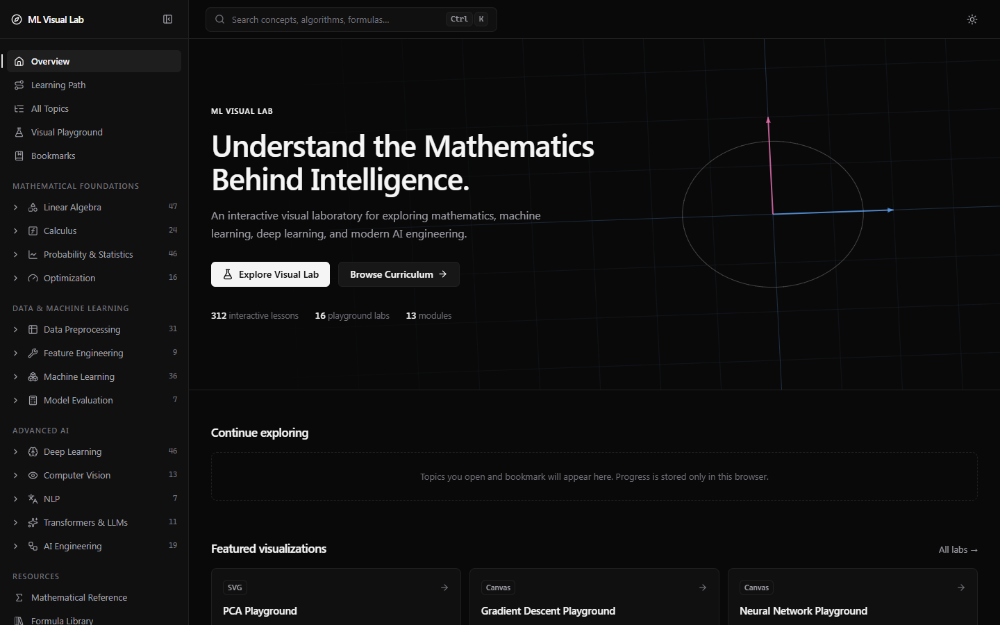
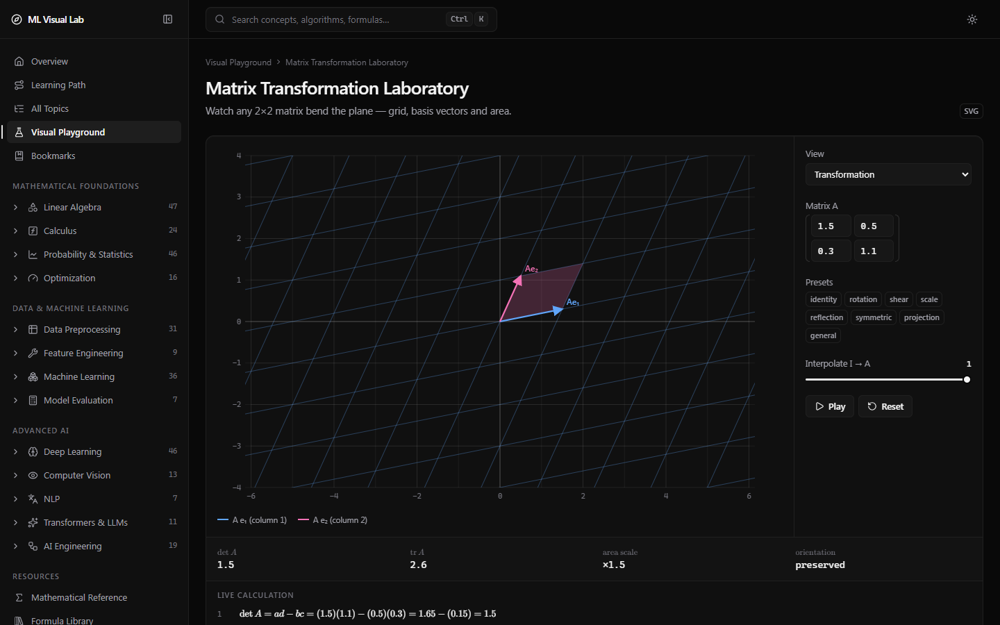
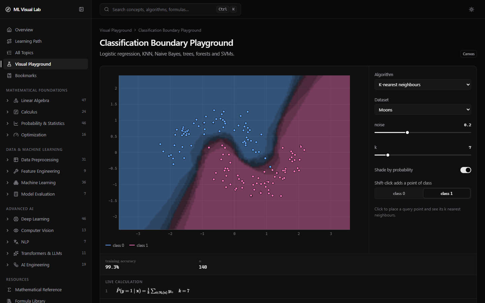
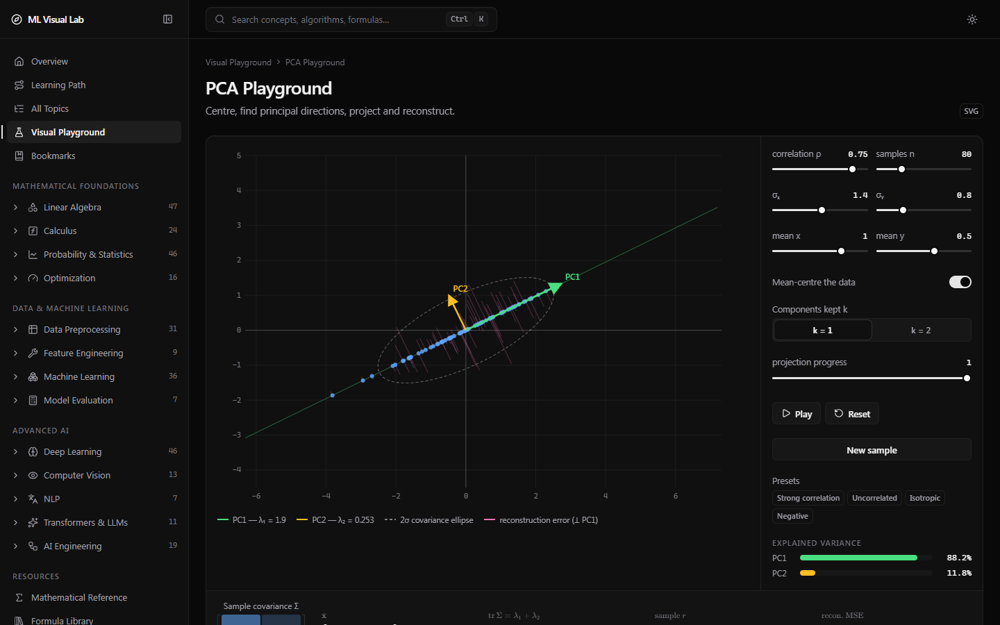
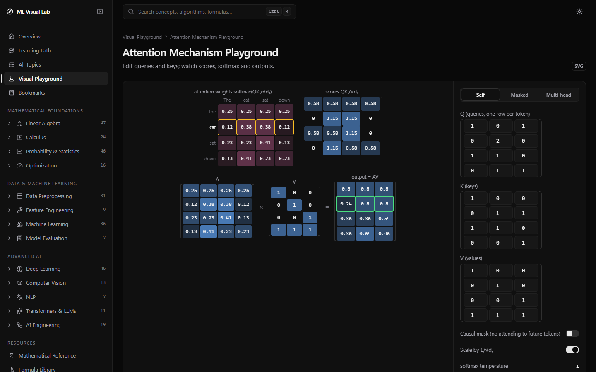
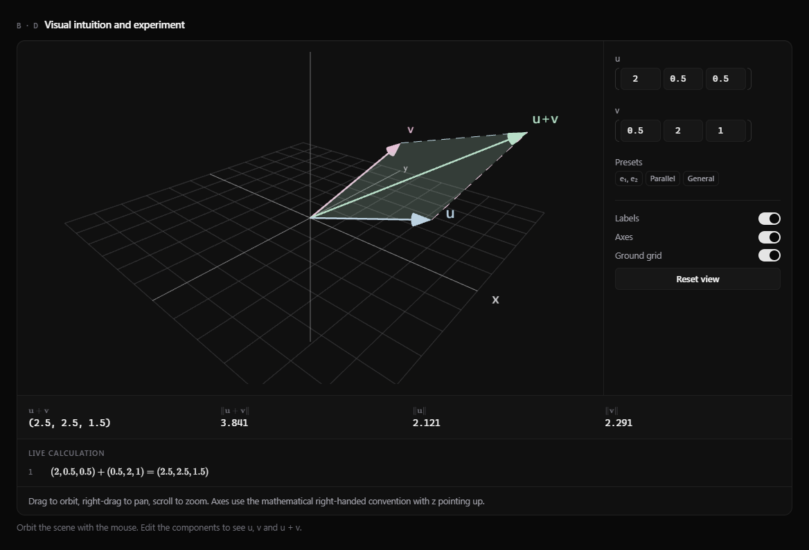
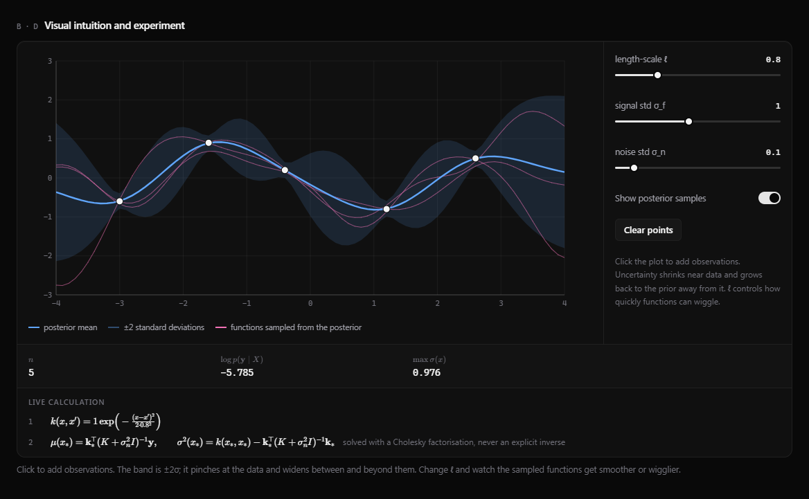
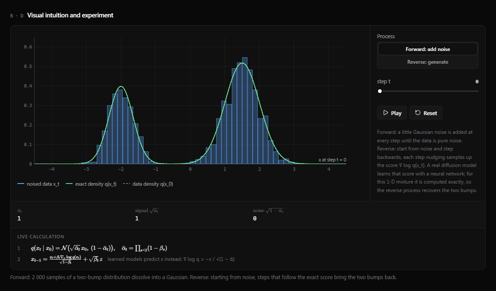
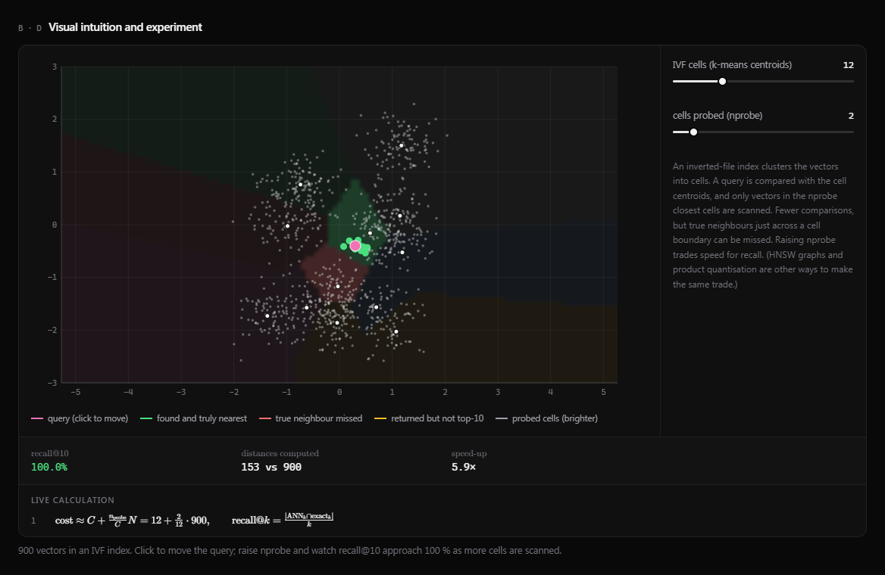
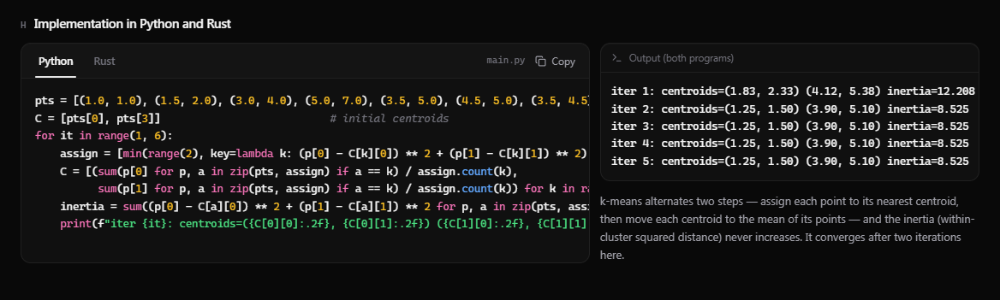

# ML Visual Lab

**An interactive visual laboratory for the mathematics of machine learning, deep learning and modern AI engineering.**

ML Visual Lab teaches 312 topics, from vectors and derivatives to diffusion models, vector databases and LLM evaluation. Every lesson pairs a short explanation with a live, manipulable visualization, step-by-step calculations and runnable Python and Rust code. It runs entirely in the browser: no backend, no accounts, no API keys.



---

## Screenshots

<table>
  <tr>
    <td width="50%"><br><sub><b>Matrix Transformation Laboratory</b> — any 2×2 matrix bends the grid, with determinant and live calculation.</sub></td>
    <td width="50%"><br><sub><b>Classification Boundary Playground</b> — decision regions of k-NN, trees, forests, SVMs and more.</sub></td>
  </tr>
  <tr>
    <td width="50%"><br><sub><b>PCA Playground</b> — principal directions, projection, reconstruction error and explained variance.</sub></td>
    <td width="50%"><br><sub><b>Attention Mechanism Playground</b> — editable Q, K, V with scores, softmax weights and outputs.</sub></td>
  </tr>
  <tr>
    <td width="50%"><br><sub><b>Vectors in 3D</b> — WebGL scene (Three.js) with orbit, pan and live vector arithmetic.</sub></td>
    <td width="50%"><br><sub><b>Gaussian Processes</b> — posterior mean, uncertainty band and sampled functions.</sub></td>
  </tr>
  <tr>
    <td width="50%"><br><sub><b>Diffusion Models</b> — forward noising and reverse generation with an exact score.</sub></td>
    <td width="50%"><br><sub><b>Vector Databases</b> — IVF approximate nearest-neighbour search with recall and speed-up.</sub></td>
  </tr>
</table>

Every lesson also ends with verified Python and Rust implementations:



---

## Highlights

- **312 interactive lessons across 13 modules**: every topic has a working visualization; there are no placeholder pages.
- **134 visualizers**: draggable vectors, matrix transformations, optimizer races, decision boundaries, t-SNE/UMAP embeddings, GANs and diffusion trained live, attention maps, IVF vector search, a model-serving queue simulation, and more.
- **16 Visual Playground labs** for free-form experimentation.
- **Real algorithms, not animations**: Jacobi eigen-solver, SVD, QR/LU, SMO-trained SVMs, CART, EM for Gaussian mixtures, BFGS, Gaussian-process regression, backpropagation (gradient-checked), BPE tokenization, BM25 and reciprocal rank fusion — all implemented in TypeScript in `src/lib` and `src/visualizers`.
- **Python + Rust for every topic**: 312 standard-library-only example pairs with syntax highlighting, a copy button, expected output and an explanation. A test suite executes every snippet and checks its printed output.
- **Live math**: formulas rendered with KaTeX, with intermediate values updating as you drag controls.
- **Fast and accessible**: each visualizer is a separate lazily loaded chunk, pages are statically generated, keyboard navigation and reduced-motion preferences are respected, and the charcoal theme has a light alternative.
- **Command palette search** (Ctrl/⌘ + K) across topics, labs and pages, with categorized results.
- **Local progress tracking**: bookmarks, completed topics and history are stored in `localStorage` only.

## Curriculum

| Module | Lessons | Examples of topics |
|---|---:|---|
| Linear Algebra | 47 | vectors, dot/cross product, matrix transformations, determinants, eigenvectors, SVD, least squares |
| Calculus | 24 | derivatives, chain rule, gradients, Jacobian, Hessian, Taylor series, computational graphs |
| Probability & Statistics | 46 | 18 distributions, CLT, Bayes, hypothesis tests, bootstrap, ANOVA, multiple testing |
| Optimization | 16 | gradient descent, momentum, Adam, learning-rate schedules, Newton, BFGS, line search, KKT |
| Data Preprocessing | 31 | scaling, power transforms, encodings, imputation, PCA, kernel PCA, t-SNE, UMAP |
| Feature Engineering | 9 | polynomial/cyclical features, lag and aggregation features, filter, wrapper and embedded selection |
| Machine Learning | 36 | linear/logistic regression, trees, ensembles, SVMs, clustering, Gaussian processes, recommenders |
| Model Evaluation | 7 | confusion matrix, ROC/PR curves, calibration, cross-validation, hyperparameter search |
| Deep Learning | 46 | activations, losses, backprop, normalization, CNNs, RNN/LSTM, autoencoders, VAEs, GANs, diffusion |
| Computer Vision | 13 | filters, edge detection, IoU/NMS, R-CNN, YOLO, segmentation, Vision Transformers, CLIP-style embeddings |
| NLP | 7 | text preprocessing, tokenization (BPE), word2vec, GloVe, positional encoding |
| Transformers & LLMs | 11 | self/cross/multi-head attention, Transformer architecture, sampling, beam search, LoRA, distillation |
| AI Engineering | 19 | data validation, feature stores, serving, drift, vector databases, RAG, hybrid search, tool calling, LLM evaluation |

Each lesson follows the same structure: definition → intuition → interactive visualization → formulas → worked example → AI/ML applications → assumptions and limitations → Python and Rust implementation → related topics.

## Tech stack

| Area | Technology |
|---|---|
| Framework | Next.js 15 (App Router, static generation), React 19, TypeScript (strict) |
| Styling | Tailwind CSS 3 with CSS-variable theme tokens |
| 2D visualization | SVG with D3 scales/shapes, HTML Canvas heatmaps |
| 3D visualization | Three.js via React Three Fiber, Plotly (loaded only where used) |
| Math typesetting | KaTeX |
| State | Zustand (persisted to `localStorage`) |
| Icons | Lucide |
| Testing | Vitest, ESLint, plus a Python/Rust execution harness |

## Getting started

### Prerequisites

- **Node.js 18.18+** (Node 20 or newer recommended) and npm
- Optional, only for `npm run test:code`: **Python 3.10+** and **Rust (`rustc`)** on your `PATH`

### Install and run

```bash
npm install
npm run dev
```

Open http://localhost:3000.

### Production build

```bash
npm run build
npm start
```

The build prerenders every page (topics, modules, labs and resource pages) as static HTML.

## Scripts

| Command | Description |
|---|---|
| `npm run dev` | Start the development server |
| `npm run build` | Create an optimized production build |
| `npm start` | Serve the production build |
| `npm run lint` | Run ESLint (`next/core-web-vitals` + `next/typescript`) |
| `npm run typecheck` | Type-check with `tsc --noEmit` |
| `npm test` | Run the unit and curriculum-integrity tests |
| `npm run test:code` | Execute all 312 Python and Rust examples and verify their printed output |

## Testing and quality checks

- **Math and ML correctness**: `tests/linalg.test.ts`, `tests/stats.test.ts`, `tests/ml.test.ts` and `tests/extra.test.ts` cover the linear-algebra routines, statistics, models, optimizers and numerical helpers (including a gradient check of backpropagation).
- **Curriculum integrity**: `tests/curriculum.test.ts` checks that every topic has the required sections, every cross-reference resolves, every visualizer id is registered and every formula renders in KaTeX.
- **TeX escaping**: `tests/escaping.test.ts` scans the source for broken backslash escapes in math strings.
- **Code examples**: `tests/code-run.test.ts` (run with `npm run test:code`) runs each Python snippet with `python -I`, compiles all Rust snippets into one crate with `rustc --edition 2021`, and requires both outputs to match the documented output exactly.

## Project structure

```
src/
  app/                    routes: /, /[module], /[module]/[topic], /playground/[lab], resource pages, loading states, favicon
  components/
    layout/               app shell
    navigation/           sidebar, command palette
    topic/                lesson layout, code tabs (Python / Rust)
    controls/             sliders, selects, toggles, animation controls
    visualization/        plotting primitives, loading indicators, Plotly wrapper
    mathematics/          KaTeX rendering
  visualizers/            134 lazily loaded visualizers, registry.tsx, ids.ts
  lib/                    math, statistics, ML models, neural networks, utilities
  data/
    curriculum/           one file per module (topics, formulas, applications)
    code/                 Python + Rust examples per module
    labs.ts               Visual Playground labs
  store/                  progress, bookmarks, theme (Zustand + localStorage)
  styles/                 global styles and theme tokens
tests/                    unit, integrity, escaping and code-execution tests
scripts/                  test helpers
docs/screenshots/         images used in this README
```

## Adding content

**A new topic**

1. Add an entry to the module file in `src/data/curriculum/`.
2. Add its Python and Rust example under the same slug in `src/data/code/<module>.ts`.
3. Run `npm test` and `npm run test:code`; they report missing sections, broken links, invalid TeX and wrong outputs.

**A new visualizer**

1. Create the component in `src/visualizers/<area>/`.
2. Add its id to `src/visualizers/ids.ts` and a lazy loader to `src/visualizers/registry.tsx`.
3. Reference the id from a topic's `visual` field.

## Privacy

There is no server-side code, telemetry or external API. Progress, bookmarks and the theme preference are stored in your browser's `localStorage` and can be cleared at any time.

## Known limitations

- A few demos use clearly labelled stand-ins for trained models: hand-placed embeddings, untrained Transformer-explorer weights, scripted tool-calling decisions (the tools themselves run), pixel-based region scores in the R-CNN demo, and fixed pooling in the U-Net illustration.
- UMAP is a simplified implementation (fixed curve parameters, random initialization).
- All computation runs on the main thread; the heaviest visualizers are memoized and sized to stay responsive.

See [`PROJECT_STATUS.md`](PROJECT_STATUS.md) for detailed status and verification notes.
